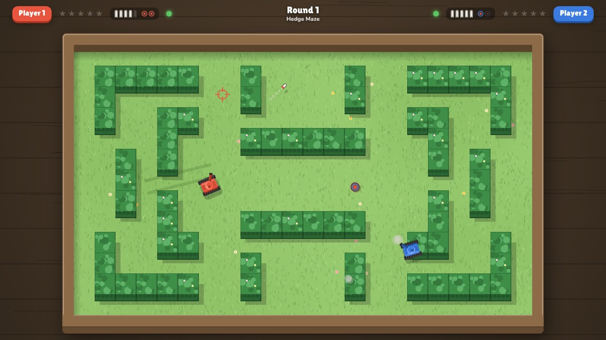

# Ricochet Rumble

A toy-tank game for the big screen (2–4 player battles, free-for-all or in teams, and a co-op campaign against CPU tanks), with **phones as controllers**: any phone over Wi-Fi by scanning a QR code, or Android phones over Bluetooth with the Ricochet Pad app.



Two tanks face off in a tabletop diorama arena.
Shells ricochet off the blocks, one hit destroys a tank, and the last tank rolling wins the round.
Lay mines to clear crates or ambush your opponent, and watch out for your own bouncing shells.

The project has two parts:

| Part | What it is | Where |
| --- | --- | --- |
| **The game** | Runs in Chrome or Edge on your computer. | [`game/`](game) |
| **Wi-Fi controller** | A web page the computer serves to phones on the same network. Works on iPhones and Android phones with nothing to install. | [`game/pad/`](game/pad) |
| **Ricochet Pad** | Android app that connects over Bluetooth instead, for when there's no usable Wi-Fi. | [`controller-android/`](controller-android) |

Any player can also use a **Wii Remote + Nunchuk** (classic Wii Play controls), an **Xbox, PlayStation or Nintendo Switch controller** (USB or Bluetooth), another gamepad, a keyboard and mouse, or the arrow keys.

### Game modes

- **Battle:** 2 to 4 players, first to 3, 5 or 7 rounds.
  - **Free-for-all:** last tank standing scores. With 3 or 4 players, the extra tanks start at the top and bottom of the arena.
  - **Teams:** pick **A** or **B** on each player card. Team-mates start side by side and wear a coloured ring (pink for A, blue for B). The last team with a tank left wins the round, and every member scores. A team-mate's mine won't go off when you drive over it, but its blast and stray shells still hurt.
  - Players 3 and 4 fold away in the lobby until you pick a controller for them. Any player can be the **Computer** (a CPU tank that banks shots off walls and lays mines), so you can play 1 vs 3 CPUs, or you and a CPU against two friends.
- **Survival:** endless waves; see below.
- **Co-op campaign:** one to four players team up against **20 stages** of CPU tanks.
  Clear every enemy tank to move on. You share 3 lives and get an extra life every 5 stages.
  A stage is lost when every player's tank is knocked out; you then retry it.
  Watch out for friendly fire.

| Enemy | Colour | What it does |
| --- | --- | --- |
| Rookie | khaki | Stays put, slow single shots, only fires when it can see you |
| Scout | sage green | Wanders about, two shells at a time |
| Bouncer | pink | Plans shots with up to two bounces off the walls |
| Dasher | orange | Fast, dodges shells, fires quick rockets |
| Sapper | charcoal | Lays mines and bank-shots you |
| Marksman | white | Stays put; fast, precise shots around corners |
| Commander | gold | Fast-firing, mobile, dodges, mines: the boss |

### Survival

Endless waves of CPU tanks warp into one arena (pick it in the lobby, or leave it on Rotation/Random for a random one).
Every wave is bigger, new enemy types join as you go, and every 10th wave brings a Commander.
Knocked-out players come back after a couple of seconds, shielded, while the team has lives.
There are 3 lives, plus one more every 5 waves. Your best wave is saved.

Two extra enemies show up in later campaign stages and in Survival:
- **Ghost** (pale blue): fades almost invisible while it moves.
- **Blaster** (red): every shot is a triple shot.

### Hats

Earn hats and wear them: pick one under your colour on your player card. Locked hats show a **?**; hover to see how to unlock it.

| Hat | Unlock |
| --- | --- |
| Party hat | Pull off a trick shot |
| Top hat | Beat the Computer in a battle |
| Cowboy hat | Clear campaign stage 5 |
| Propeller cap | Reach wave 5 in Survival |
| Viking helmet | Grab 25 power-ups (in total) |
| Chef hat | Destroy 100 CPU tanks (in total) |
| Crown | Clear the whole campaign |

### Power-ups

With **Power-ups** on (lobby), glowing pickups appear in the arena every so often. In a battle they arrive in mirrored pairs, and grabbing one makes its twin vanish.
Drive over one to take it:

| Power-up | Colour | Effect |
| --- | --- | --- |
| Shield | blue | Blocks one hit (shell or mine) |
| Turbo | yellow | Drive 50% faster for 8 s |
| Triple shot | red | Every shot fires three shells for 9 s |
| Super bounce | purple | Shells bounce two extra times for 12 s |
| Rapid fire | green | Three more shells in the air and a faster trigger for 10 s |

---

## What you need

- **A computer** running **Google Chrome or Microsoft Edge** (Windows 10/11, macOS or Linux).
- **One or two phones**, connected one of two ways:
  - **Wi-Fi (any phone):** the phones and the computer must be on the same Wi-Fi network. It doesn't need internet access. Nothing to install.
  - **Bluetooth (Android only):** the phone needs the Ricochet Pad app (Android 8.0 or newer), and the computer needs Bluetooth. Linux needs one browser flag (see [Troubleshooting](#troubleshooting)).

## 1. (Bluetooth only) Install the Android app on each phone

Skip this if everyone is joining over Wi-Fi.

**Option A: download it on the phone (easiest).**

1. On the phone, open Chrome and sign in at [github.com](https://github.com). The repository is private, so the link only works when you're signed in.
2. Open **https://github.com/trout1758-cpu/Wii-Tanks/releases/download/controller-latest/RicochetPad.apk**.
   GitHub rebuilds this file every time the app changes, so the same link always gets the newest version.
3. Open the downloaded file.
   The first time, Android asks you to allow Chrome to install apps; turn that on.
   If Play Protect warns about an unknown app, tap **More details → Install anyway**.

To update later, open the same link again and install over the old version; your settings are kept.
Every build is signed with the same development key (`controller-android/app/ricochetpad-dev.keystore`), which is what lets updates install over each other.

**Option B: build it yourself.**
Open the `controller-android` folder in Android Studio and press **Run** with your phone plugged in (USB debugging on).
From the command line, run `./gradlew assembleRelease`; the APK lands in `app/build/outputs/apk/release/`.

The first time the app opens, it asks for the **Nearby devices** (Bluetooth) permission.
Allow it.

## 2. Start the game on the computer

| System | How |
| --- | --- |
| Windows | Double-click **`start-game.bat`**. |
| macOS / Linux | Run **`./start-game.sh`** (needs `python3`). |

Each script starts a small local server and opens **http://localhost:8080** in Chrome or Edge.
Keep the script's window open while you play.
The same server hands the Wi-Fi controller to phones on your network; nothing goes over the internet.

The first time on Windows, a firewall window asks whether to allow access.
Click **Allow** (if there are checkboxes, tick the one for your type of network), or phones won't be able to connect.
If the Wi-Fi server can't start for any reason, the script says so and starts in local-only mode, where the Android app, keyboards and gamepads still work.

> Why not just open `index.html`? Wi-Fi phones need the local server, and browsers only allow Bluetooth on secure pages: `http://localhost` counts as one, but a local file doesn't.
> Keyboard and gamepad play also work if you open the file directly.

## 3. Connect the phones

### Over Wi-Fi (any phone)

1. Make sure the phone is on the **same Wi-Fi network** as the computer.
2. In the game, click **Play**, then **Phone · scan QR code** on a player card.
3. Point the phone's camera at the QR code and open the link.
   The controller opens in the phone's browser and the pill turns into **PLAYER 1** (or 2).
4. Turn the phone sideways.

On Android, the first tap makes it full screen.
On iPhone, Safari can't hide its bars for a web page; for a full-screen controller, tap **Share → Add to Home Screen** and open it from there.
If the phone drops off the Wi-Fi, the game pauses and the phone reconnects to the same tank by itself when the network comes back.

### Over Bluetooth (Android app)

1. Open **Ricochet Pad** on the phone.
   The top-left pill says **WAITING FOR GAME**, and the screen shows the name to look for (your phone's Bluetooth name).
2. In the game, click **Play**, then click **Android app** on the Player 1 card.
3. Chrome opens a Bluetooth list.
   Pick your phone and click **Pair** / **Connect**.
4. The phone's pill turns into **PLAYER 1** in that tank's colour, and it buzzes.
5. Repeat on the other player cards (up to 4 players) with more phones, or pick another controller type.
6. Press **fire** on both controllers to ready up (tap the right half of the phone screen), or click **Start match**.

Try the sticks in the lobby: the tank picture on your card follows your phone, so you can check it works before the match starts.

---

## Controls

### Phone (Wi-Fi controller or Ricochet Pad)

Both look and work the same.

| Control | Action |
| --- | --- |
| **Left half**: drag | Drive. The tank turns toward the stick direction and reverses when that's quicker. |
| **Right half**: drag | Aim the turret. A dotted guide appears on the TV. |
| **Right half**: let go | Fire. Slide back to the centre before letting go to cancel. |
| **Right half**: quick tap | Fire wherever the turret already points. |
| **MINE** button (top middle) | Drop a mine. |
| Your name pill (top left, in the lobby) | Change your name and tank colour. |
| **Pause** button (top bar) | Pause or resume. |
| Settings button (top bar) | Turn fire-on-release, vibration or left-handed layout on or off. |

The phone vibrates when you fire, lay a mine, get hit, score a hit, or a mine blows up nearby.
iPhones don't let web pages vibrate, so the Wi-Fi controller on an iPhone is silent; everything else works.
It also shows the score, your remaining shells and mines, and the game state.

### Keyboard, mouse and gamepad

| Scheme | Drive | Aim | Fire | Mine | Pause |
| --- | --- | --- | --- | --- | --- |
| Keys + mouse | `WASD` | mouse | left click / `F` | `Space` / right click / `E` | `Esc` |
| Arrow keys | arrows | `,` `.` rotate turret | `/` / `Enter` | `Right Shift` / `'` | `Esc` |
| Xbox controller | left stick or D-pad | right stick | RT / RB / A | LT / LB / B | Menu |
| PlayStation controller | left stick or D-pad | right stick | R2 / R1 / ✕ | L2 / L1 / ○ | Options |
| Switch Pro / Joy-Con pair | left stick or D-pad | right stick | ZR / R / B | ZL / L / A | + |
| Single Joy-Con (sideways) | stick | follows the way you drive | SR / face buttons | SL | + / − |

To use a controller, pick **Xbox controller**, **PlayStation controller**, **Nintendo Switch controller** or **Other gamepad** in a player card's **Controller** menu, then press any button on it. Connect it first, either over USB or by pairing it in your computer's Bluetooth settings:

- **Xbox:** hold the small pairing button on top until the Xbox logo flashes fast.
- **PlayStation (DualShock 4 / DualSense):** hold **Share** (or **Create**) and **PS** until the light flashes.
- **Switch Pro / Joy-Con:** hold the small sync button until the lights run.

The game reads the controller's name to show the right button names. Pads it doesn't recognise get a best-effort layout: the stick or D-pad drives, and if there is no second stick, the turret points the way you drive. Rumble works where the browser supports it (Xbox and PlayStation controllers in Chrome and Edge).

### Wii Remote + Nunchuk

The classic Wii Play Tanks controls:

| Drive | Aim | Fire | Mine | Pause |
| --- | --- | --- | --- | --- |
| Nunchuk stick | point the Wii Remote at the screen | B (trigger) or Z | A or C | + or Home |

1. **Pair each Wii Remote with the computer once.**
   - **Windows:** Settings → Bluetooth & devices → Add device → Bluetooth.
     Press the red **sync** button inside the battery cover (or hold **1 + 2**).
     Pick **Nintendo RVL-CNT-01**. If it asks for a PIN, leave it blank / skip.
   - Plug the Nunchuk in before or after; either works.
2. Open the game with the start script, in **Chrome** or **Edge**.
3. Pick **Wii Remote + Nunchuk** in a player card's **Controller** menu and choose the remote in the list. Its player light comes on.
4. In menus, the Wii Remote is a pointer: aim at a button and press **A** to click it.

**Aiming needs a sensor bar** in front of or on top of the screen (a Wii's own bar needs the Wii switched on; USB sensor bars work too).
Without one, the remote falls back to **tilt aiming**: tip it forwards/back and twist it left/right to swing the turret.
Without a Nunchuk, the D-pad drives.

If a Wii Remote turns itself off, press any button on it to reconnect (on Windows you may need to press sync again).

---

## Rules and mechanics

- **One hit destroys a tank.** Last tank standing wins the round. If both go down within a moment of each other, the round is a draw.
- **Shells ricochet.** They bounce off blocks and walls, and they can destroy the tank that fired them.
- **Limited ammo in the air.** You can only have a few shells flying at once. A new one is available as soon as one disappears.
- **Shells collide.** Two shells that meet destroy each other, so you can shoot an incoming shell out of the air.
- **Mines.** You can have two out at a time. A mine arms after a moment, blinks faster as its fuse runs down, and explodes after 10 seconds. It goes off early if the enemy drives close or anyone shoots it. Blasts destroy tanks, crates and shells in range, and set off other mines.
- **Crates** block tanks and shells, but a mine blast clears them.
- **Pits and ponds** stop tanks, but shells fly straight over them.
- First to 3, 5 or 7 round wins takes the match.

### Arena effects

Most themes have their own twist, shown under the arena preview in the lobby and in the round banner.
Turn **Arena effects** off in the lobby for plain rules.

| Theme | Effect |
| --- | --- |
| Frost | **Slippery ice**: tanks slide and take a moment to stop or turn. |
| Space | **Black holes** bend shells that pass nearby and swallow any that fly into them. |
| Volcano | **Eruptions**: every few seconds the lava lobs fireballs; get out of the red warning circles. |
| Beach | **Tide**: every so often the tide comes in and halves your speed near the water. |
| Playroom | **Bouncy blocks**: shells bounce one extra time. |
| Sandbox | **Sandstorms** blow through and hide everything except the area around each tank. |
| Garden | **Regrowth**: blasted planters grow back after a while. |
| Factory | **Conveyor belts** carry tanks along (they still drive, the belt just adds to it). |
| Arcade | **Teleporters**: tanks *and shells* that touch a glowing pad come out of its partner. Portal kills count as trick shots. |
| Castle | **Gates**: two sets of barred gates take turns to swing shut every few seconds. A gate never shuts on a tank. |
| Haunted | **Lights out**: it's dark. Your headlight shows where your turret points; shells, explosions and the odd lightning flash light things up. |
| Sky | **Gusts**: wind blows north or south every so often, shoving tanks and curving shells. |
| Workshop, Blueprint, Kitchen | Classic rules. |

Random events (eruptions) always happen in mirrored pairs, so neither side gets an advantage.

### Trick shots and instant replay

Special kills get a callout: **BANK SHOT!** (one bounce), **TRICK SHOT!** (two), **INCREDIBLE!** (three or more), **GRAVITY ASSIST!** (bent by a black hole), plus **KABOOM!**, **ROASTED!**, **OWN GOAL!**, and **INTERCEPTED!** when two players' shells collide.
Trick shots are counted on the results screen.

After each kill, the last few seconds replay in slow motion, zoomed in on the action.
Press fire on any controller (or Space / Enter / Esc) to skip it, or turn **Instant replay** off in the lobby.

### Tuning

All numbers live in [`game/js/config.js`](game/js/config.js). Distances are in arena tiles; the arena is 22 × 13 tiles.

| | Value |
| --- | --- |
| Tank speed | 2.4 tiles/s; hull turns ~300°/s; turret ~800°/s |
| Fire cooldown | 0.16 s |
| Classic shells | 5.6 tiles/s · 1 bounce · 5 in the air |
| Rubber shells | 4.4 tiles/s · 3 bounces · 4 in the air |
| Rocket shells | 9.6 tiles/s · 1 bounce · 2 in the air |
| Mines | 2 per tank · arms in 0.8 s · 10 s fuse · triggers within 1.05 tiles (0.4 s delay) · 1.75-tile blast |

The ammo type and mines on/off are chosen in the lobby.

### Arenas

There are 34 arenas across 15 themes.
Every arena is symmetric, so both sides are equal.
Most are mirrored left-to-right; the ones marked ↻ are rotated instead, so the players start in opposite corners.

| Arena | Theme | Feature |
| --- | --- | --- |
| Opening Gambit | Workshop | A simple layout to learn on |
| Dunes ↻ | Beach | Rock piles, driftwood and tide pools |
| Crate Alley | Sandbox | Crate walls to blast through |
| Kitchen Table | Kitchen | A long wall down the middle, boxes in the corners |
| The Moat | Frost | Icy pond in the middle; shells fly over, tanks go around |
| Lava Lake | Volcano | A ring of lava around the centre, crate walls for cover |
| Hedge Maze | Garden | Tight corridors |
| Starfield ↻ | Space | Scattered blocks and black holes |
| Checkerboard | Playroom | Scattered toy blocks for bank shots |
| Bridges | Beach | Two channels with narrow crossings |
| Twin Forts | Blueprint | Walled bases with crate doors |
| Three Lanes | Workshop | Long parallel lanes and a walled middle |
| Bank Shot | Workshop | Long walls built for ricochets |
| Moat Castle | Frost | A castle behind a moat; mine the gate to get in |
| Crossroads | Frost | A cross of cover in the middle |
| Pinball | Playroom | Dozens of blocks; shots bounce everywhere |
| Lily Pads | Garden | Ponds and planters |
| Lava River ↻ | Volcano | Two diagonal lava rivers |
| Toy Box | Playroom | Crates and blocks everywhere |
| Gauntlet | Space | Staggered pillars to dodge between |
| Bunkers | Sandbox | Crate bunkers around each spawn |
| Checkmate ↻ | Kitchen | A checkerboard of blocks and boxes |
| Spiral ↻ | Blueprint | Two interlocking spirals |
| Snowball Fort | Frost | Snow walls and ice blocks |
| Assembly Line | Factory | Belt strips to ride (or fight against) |
| Sorting Room | Factory | A conveyor loop round each half |
| Warp Zone | Arcade | Corner teleporters for surprise flanks and portal shots |
| Short Circuit ↻ | Arcade | Three teleporter pairs |
| Portcullis | Castle | Start inside a fort with four gates |
| Gatehouse | Castle | A wall down each side with gates taking turns |
| Graveyard | Haunted | Tombstones and open graves in the dark |
| Old Manor ↻ | Haunted | Dark corridors and rooms |
| Rooftops | Sky | Gaps between roofs; shells fly over them |
| Cloud Bridges | Sky | Narrow bridges over the sky |

Choose **Rotation** to play them in this order, **Random**, or a single arena.
To make your own, add an entry to [`game/js/arenas.js`](game/js/arenas.js).
You draw the left half; the right half is mirrored automatically, or rotated if you add `sym: 'rotate'`.

---

## Troubleshooting

**A phone can't open the QR code link, or it stays on CONNECTING….**
- The phone must be on the same Wi-Fi network as the computer, not on mobile data.
- On Windows, the firewall may be blocking it. If you missed the "Allow" prompt, open *Windows Security → Firewall → Allow an app through firewall* and allow **Windows PowerShell** for your network type.
- Some networks stop devices from seeing each other: hotels, schools, cafés and many "guest" networks. There, or wherever the Wi-Fi keeps dropping out, make your own network instead. Turn on a phone's hotspot and connect the computer and the other phones to it; it doesn't need mobile data for this. A cheap travel router works too.
- If the computer has several network connections (VPN, virtual machines), click **Try another address** under the QR code.

**My Android phone isn't in Chrome's Bluetooth list.**
- Make sure Ricochet Pad is open on the phone and says **WAITING FOR GAME**. It only advertises while it's on screen.
- Make sure Bluetooth is on for both the phone and the computer.
- Don't pair the phone in Windows or Android Bluetooth settings first. The game connects directly.
- A phone can only control one player at a time. If it's already connected, it stops advertising.

**The lobby says "Android app (Bluetooth) unavailable".**
The page was opened as a file or in a browser without Web Bluetooth (Firefox and Safari don't have it).
Use the start script and Chrome or Edge.

**Linux.**
Open `chrome://flags/#enable-experimental-web-platform-features`, enable it, and restart Chrome.
You also need BlueZ 5.41 or newer.

**A phone disconnected mid-match.**
The game pauses and keeps trying to reconnect on its own.
Wi-Fi phones come back to the same tank automatically.
For the Android app:
If you closed and reopened the app, Android may have switched to a new Bluetooth address.
In that case, click **Re-pair … phone** on the pause screen and pick it again.

**The controls feel laggy.**
Keep the phones within a few metres of the computer and away from crowded 2.4 GHz gear.
USB Bluetooth dongles at the back of a PC case can struggle, so try a short USB extension.

**Leaving the app.**
Back needs a double press, so a stray swipe mid-match doesn't close the controller.
Switching away from the app disconnects it; the game pauses until you return.

---

## Project layout

```
game/                      Desktop game (plain HTML/CSS/JS, no build step)
  index.html
  css/style.css
  js/config.js             Tuning values
  js/arenas.js             Arena layouts and visual themes
  js/world.js              Simulation (tanks, shells, mines, collisions)
  js/render.js             Canvas renderer, particles, decals
  js/audio.js              Synthesised sound effects and music
  js/ai.js                 CPU tank brains: shot tracing with bounces, pathfinding, dodging
  js/campaign.js           Co-op campaign stages
  js/input.js              Keyboard, mouse and gamepad
  js/wiimote.js            Wii Remotes + Nunchuk over WebHID (IR pointer, tilt fallback, rumble)
  js/ble.js                Android app over Web Bluetooth
  js/wifi.js               Phone controllers over Wi-Fi (WebSocket via the launcher)
  js/vendor/qrcode.js      QR code generator (Kazuhiko Arase, MIT licence)
  pad/                     Wi-Fi controller page served to phones
  js/protocol.js           Bluetooth packet format
  js/main.js               Menus, rounds, HUD, controller feedback
  tests/run.js             Headless tests for the simulation and protocol
controller-android/        Ricochet Pad (Kotlin, no external libraries)
launcher/server.py         Local server for macOS / Linux (game, Wi-Fi controller, relay)
launcher/RicochetServer.cs Same server for Windows, compiled by start-game.ps1
docs/PROTOCOL.md           Controller protocol (Bluetooth and Wi-Fi)
start-game.bat / .ps1 / .sh  Launchers
```

Run the simulation tests with:

```sh
node game/tests/run.js
```

Add `?debug` to the game URL for an FPS counter.

---

Ricochet Rumble is an original game in the classic top-down tank-duel genre.
The art, sounds, music and arenas were all made for this project, and the sounds and music are generated in code.
