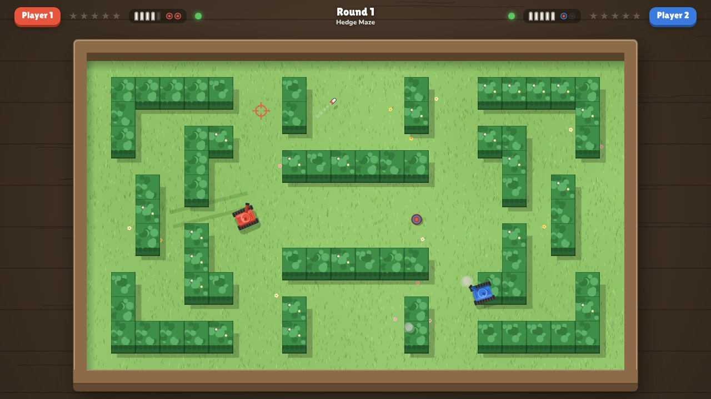

# Ricochet Rumble

A two-player toy-tank duel for the big screen, with **Android phones as Bluetooth controllers**.



Two tanks face off in a tabletop diorama arena.
Shells ricochet off the blocks, one hit destroys a tank, and the last tank rolling wins the round.
Lay mines to clear crates or ambush your opponent, and watch out for your own bouncing shells.

The project has two parts:

| Part | What it is | Where |
| --- | --- | --- |
| **The game** | Runs in Chrome or Edge on your computer and connects to phones with Web Bluetooth. | [`game/`](game) |
| **Ricochet Pad** | Android app that turns a phone into a twin-stick controller. | [`controller-android/`](controller-android) |

Either player can also use a keyboard and mouse, the arrow keys, or a USB/Bluetooth gamepad.

---

## What you need

- **A computer with Bluetooth** running **Google Chrome or Microsoft Edge**.
  This works on Windows 10/11, macOS and ChromeOS.
  Linux needs one flag (see [Troubleshooting](#troubleshooting)).
- **One or two Android phones**, Android 8.0 or newer, with the Ricochet Pad app.
  Practically every phone from the last several years supports the Bluetooth LE peripheral mode the app needs.

## 1. Install the controller app on each phone

**Option A: download the APK built by GitHub Actions.**

- After this work is merged to `main`, the APK is published as a release named **controller-latest**.
  On the phone, open the repository's **Releases** page, download `RicochetPad.apk`, and open it.
  You can also run the "Android controller APK" workflow by hand from the Actions tab.
- Before that, every push still builds the APK.
  Open the latest run of **Actions → Android controller APK** and download the `RicochetPad-apk` artifact.
  It's a zip; extract `RicochetPad.apk` and copy it to the phone.
- Android will ask you to allow installing apps from your browser or file manager the first time.

**Option B: have every build sent to your phone with Firebase App Distribution.**
Once this is set up, each push that changes the app emails you, and the Firebase **App Tester** app on your phone offers the update.
The setup is a one-time job of about 10 minutes, done on a computer:

1. In the [Firebase console](https://console.firebase.google.com/), create a project.
   The free plan is enough, and you can skip Google Analytics.
2. Click **Add app → Android** and enter the package name `com.ricochetrumble.controller`.
   Register the app, then skip the `google-services.json` and SDK steps, which aren't needed.
3. Open **App Distribution** (under *Release & Monitor*) and click **Get started**.
4. Copy the **App ID** from **Project settings → General → Your apps**.
   It looks like `1:123456789:android:abc123…`.
5. Create a key that lets GitHub upload builds:
   - Go to **Project settings → Service accounts** and click the link to manage service account permissions in Google Cloud.
   - **Create service account**, give it the role **Firebase App Distribution Admin**, and finish.
   - Open the new account, go to **Keys → Add key → JSON**, and save the downloaded file.
6. In this GitHub repository, go to **Settings → Secrets and variables → Actions** and add three repository secrets:

   | Secret | Value |
   | --- | --- |
   | `FIREBASE_APP_ID` | the App ID from step 4 |
   | `FIREBASE_SERVICE_ACCOUNT` | the whole contents of the JSON key file from step 5 |
   | `FIREBASE_TESTERS` | the email address(es) to send builds to, comma-separated |

7. Open **Actions → Android controller APK**, pick the latest run, and click **Re-run all jobs**.
   On your phone, open the invite email from Firebase, accept it, and follow the prompts to install **App Tester** and then Ricochet Pad.

Until the secrets exist, the Firebase step is skipped and the build still succeeds.

Every build is signed with the same development key (`controller-android/app/ricochetpad-dev.keystore`), so new versions install over old ones.
If you installed a build from before that key was added, uninstall it once first.

**Option C: build it yourself.**
Open the `controller-android` folder in Android Studio and press **Run** with your phone plugged in (USB debugging on).
From the command line, run `./gradlew assembleRelease`; the APK lands in `app/build/outputs/apk/release/`.

The first time the app opens, it asks for the **Nearby devices** (Bluetooth) permission.
Allow it.

## 2. Start the game on the computer

| System | How |
| --- | --- |
| Windows | Double-click **`start-game.bat`**. |
| macOS / Linux | Run **`./start-game.sh`** (needs `python3`). |

Each script starts a tiny local web server and opens **http://localhost:8080** in Chrome or Edge.
Keep the script's window open while you play.

> Why not just open `index.html`? Browsers only allow Bluetooth on secure pages, and `http://localhost` counts as one but a local file doesn't.
> Keyboard and gamepad play also work if you open the file directly.

## 3. Connect the phones

1. Open **Ricochet Pad** on the phone.
   The top-left pill says **WAITING FOR GAME**, and the screen shows the name to look for (your phone's Bluetooth name).
2. In the game, click **Play**, then click **Phone** on the Player 1 card.
3. Chrome opens a Bluetooth list.
   Pick your phone and click **Pair** / **Connect**.
4. The phone's pill turns into **PLAYER 1** in that tank's colour, and it buzzes.
5. Repeat on the Player 2 card with the second phone, or pick another controller type.
6. Press **fire** on both controllers to ready up (tap the right half of the phone screen), or click **Start match**.

Try the sticks in the lobby: the tank picture on your card follows your phone, so you can check it works before the match starts.

---

## Controls

### Phone (Ricochet Pad)

| Control | Action |
| --- | --- |
| **Left half**: drag | Drive. The tank turns toward the stick direction and reverses when that's quicker. |
| **Right half**: drag | Aim the turret. A dotted guide appears on the TV. |
| **Right half**: let go | Fire. Slide back to the centre before letting go to cancel. |
| **Right half**: quick tap | Fire wherever the turret already points. |
| **MINE** button | Drop a mine. |
| **Pause** button (top bar) | Pause or resume. |
| Settings button (top bar) | Turn fire-on-release, vibration or left-handed layout on or off. |

The phone vibrates when you fire, lay a mine, get hit, score a hit, or a mine blows up nearby.
It also shows the score, your remaining shells and mines, and the game state.

### Keyboard, mouse and gamepad

| Scheme | Drive | Aim | Fire | Mine | Pause |
| --- | --- | --- | --- | --- | --- |
| Keys + mouse | `WASD` | mouse | left click / `F` | `Space` / right click / `E` | `Esc` |
| Arrow keys | arrows | `,` `.` rotate turret | `/` / `Enter` | `Right Shift` / `'` | `Esc` |
| Gamepad | left stick | right stick | RT / RB / A | LT / LB / B | Start |

To use a gamepad, click **Gamepad** on a player card and press any button on the pad.

---

## Rules and mechanics

- **One hit destroys a tank.** Last tank standing wins the round. If both go down within a moment of each other, the round is a draw.
- **Shells ricochet.** They bounce off blocks and walls, and they can destroy the tank that fired them.
- **Limited ammo in the air.** You can only have a few shells flying at once. A new one is available as soon as one disappears.
- **Shells collide.** Two shells that meet destroy each other, so you can shoot an incoming shell out of the air.
- **Mines.** You can have two out at a time. A mine arms after a moment, blinks faster as its fuse runs down, and explodes after 10 seconds. It goes off early if the enemy drives close or anyone shoots it. Blasts destroy tanks, crates and shells in range, and set off other mines.
- **Crates** block tanks and shells, but a mine blast clears them.
- **Pits and ponds** stop tanks, but shells fly straight over them.
- First to 3, 5 or 7 round wins takes the match.

### Tuning

All numbers live in [`game/js/config.js`](game/js/config.js). Distances are in arena tiles; the arena is 22 × 13 tiles.

| | Value |
| --- | --- |
| Tank speed | 2.4 tiles/s; hull turns ~300°/s; turret ~800°/s |
| Fire cooldown | 0.16 s |
| Classic shells | 5.6 tiles/s · 1 bounce · 5 in the air |
| Rubber shells | 4.4 tiles/s · 3 bounces · 4 in the air |
| Rocket shells | 9.6 tiles/s · 1 bounce · 2 in the air |
| Mines | 2 per tank · arms in 0.8 s · 10 s fuse · triggers within 1.05 tiles (0.4 s delay) · 1.75-tile blast |

The ammo type and mines on/off are chosen in the lobby.

### Arenas

Every arena is mirrored left-to-right, so both sides are equal.

| Arena | Theme | Feature |
| --- | --- | --- |
| Opening Gambit | Workshop | A simple layout to learn on |
| Crate Alley | Sandbox | Crate walls to blast through |
| The Moat | Frost | Icy pond in the middle; shells fly over, tanks go around |
| Hedge Maze | Garden | Tight corridors |
| Checkerboard | Playroom | Scattered toy blocks for bank shots |
| Twin Forts | Blueprint | Walled bases with crate doors |
| Bank Shot | Workshop | Long walls built for ricochets |
| Crossroads | Frost | A cross of cover in the middle |
| Lily Pads | Garden | Ponds and planters |
| Toy Box | Playroom | Crates and blocks everywhere |

Choose **Rotation** to play them in order, **Random**, or a single arena.
To make your own, add an entry to [`game/js/arenas.js`](game/js/arenas.js): you draw the left half and it's mirrored automatically.

---

## Troubleshooting

**My phone isn't in Chrome's Bluetooth list.**
- Make sure Ricochet Pad is open on the phone and says **WAITING FOR GAME**. It only advertises while it's on screen.
- Make sure Bluetooth is on for both the phone and the computer.
- Don't pair the phone in Windows or Android Bluetooth settings first. The game connects directly.
- A phone can only control one player at a time. If it's already connected, it stops advertising.

**The lobby says "Phone controllers unavailable".**
The page was opened as a file or in a browser without Web Bluetooth (Firefox and Safari don't have it).
Use the start script and Chrome or Edge.

**Linux.**
Open `chrome://flags/#enable-experimental-web-platform-features`, enable it, and restart Chrome.
You also need BlueZ 5.41 or newer.

**A phone disconnected mid-match.**
The game pauses and keeps trying to reconnect on its own.
If you closed and reopened the app, Android may have switched to a new Bluetooth address.
In that case, click **Re-pair … phone** on the pause screen and pick it again.

**The controls feel laggy.**
Keep the phones within a few metres of the computer and away from crowded 2.4 GHz gear.
USB Bluetooth dongles at the back of a PC case can struggle, so try a short USB extension.

**Leaving the app.**
Back needs a double press, so a stray swipe mid-match doesn't close the controller.
Switching away from the app disconnects it; the game pauses until you return.

---

## Project layout

```
game/                      Desktop game (plain HTML/CSS/JS, no build step)
  index.html
  css/style.css
  js/config.js             Tuning values
  js/arenas.js             Arena layouts and visual themes
  js/world.js              Simulation (tanks, shells, mines, collisions)
  js/render.js             Canvas renderer, particles, decals
  js/audio.js              Synthesised sound effects and music
  js/input.js              Keyboard, mouse and gamepad
  js/ble.js                Phone controllers over Web Bluetooth
  js/protocol.js           Bluetooth packet format
  js/main.js               Menus, rounds, HUD, controller feedback
  tests/run.js             Headless tests for the simulation and protocol
controller-android/        Ricochet Pad (Kotlin, no external libraries)
docs/PROTOCOL.md           Bluetooth protocol between phone and game
start-game.bat / .ps1 / .sh  Local launchers
```

Run the simulation tests with:

```sh
node game/tests/run.js
```

Add `?debug` to the game URL for an FPS counter.

---

Ricochet Rumble is an original game in the classic top-down tank-duel genre.
The art, sounds, music and arenas were all made for this project, and the sounds and music are generated in code.
